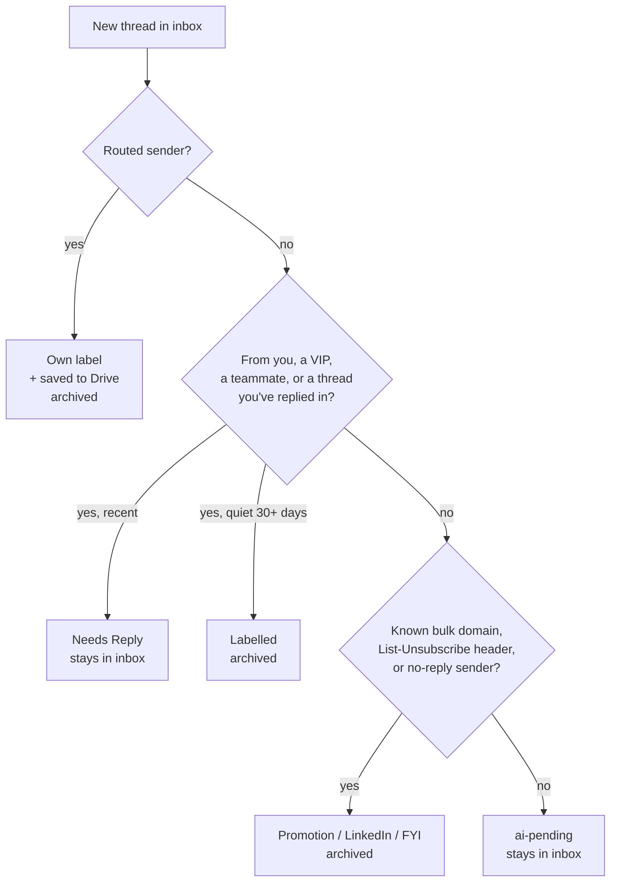

# inbox-triage

**An inbox that only holds people waiting on you.** A Google Apps Script that runs every 15 minutes, keeps your teammates and the conversations you're part of, and labels and archives everything else. Nothing gets deleted, and everything stays searchable under a label.

There's no API key, no model call and no subscription. It's under 500 lines of rules you can read in one sitting.



## What it decides, in order

Every keep rule runs before any archive rule, so a teammate who sends a newsletter is still a teammate.

| Rule | Result |
|---|---|
| Sent from one of your own addresses | kept, `ai-mine` |
| VIP sender | kept, `Needs Reply` |
| Teammate (your domains) | kept, `Needs Reply`. Your own domain's `noreply@` goes to `FYI` |
| A thread you've already replied in | kept, `Needs Reply` |
| Any of the above, quiet for `KEEP_DAYS` | labelled, then archived |
| Known bulk domain (subdomains included) | archived, `Promotion` or `LinkedIn` |
| `List-Unsubscribe`, `List-Id` or bulk `Precedence` header | archived, `Promotion` |
| Automated sender (`noreply`, `notifications`, `billing`...) | archived, `FYI` |
| A stranger, no unsubscribe header | **`ai-pending`, left in the inbox** |

That last row is the design. A real intro and a cold pitch look identical to a rule, so the script doesn't guess. It flags the thread and leaves it where you'll see it. Once you reply, the next run promotes it to `Needs Reply` by itself.

Two smaller details that took a backlog to find:

- **The no-reply match is unanchored.** Matching only at the start of the address misses `businessprofile-noreply@`, `updates-noreply@`, `editors-noreply@` and `messaging-digest-noreply@`. The pattern looks for the marker anywhere between separators, and the tests confirm `newsom@` is still treated as a person.
- **Staleness is judged by the last message.** Gmail's `before:` matches a thread if *any* message is old, so a two-month thread that got a reply this morning comes back from the search. The sweep checks the last message date before archiving anything.

## Setup

1. Open [script.google.com](https://script.google.com), create a project, and add the three files from `src/`: `Code.gs`, `appsscript.json` (Project Settings → show manifest) and a `Config.gs` copied from `Config.example.gs`.
2. Edit `Config.gs`: your addresses, your team's domain, any VIPs.
3. Run `createLabels`, then `previewInboxCleanup` if your inbox is already thousands deep. It only counts. `runInboxCleanup` archives what it counted.
4. Run `triageInbox` once by hand and read the log. Each thread gets one line saying which rule fired and why.
5. Run `setupTrigger` to install the 15-minute schedule.

`status()` is the health check. The only silent failure left is the trigger quietly disappearing, so that's the first line it reports.

The `appsscript.json` turns on the advanced Gmail service, which is what reads the `List-Unsubscribe` header. Without it the script falls back to scanning the email footer for "unsubscribe", which works, just less precisely.

## Tuning

Look at `label:ai-pending` once a week. Most of what you'll find there is a bulk sender the rules don't know yet. Add its domain to `ALWAYS_ARCHIVE_DOMAINS` and it never comes back. That one list is where almost all the tuning happens.

`ROUTES` gives a sender its own label and, optionally, saves each email as a `.txt` file in a Drive folder before archiving. I use it to keep one newsletter as a searchable corpus without it ever sitting in my inbox.

## Tests

```bash
node test/run.mjs
```

The harness loads the real `.gs` files into Node against a fake Gmail and runs 13 cases: every rule above, the failure path, and the stale sweep. Pass your own config to check your edits: `node test/run.mjs src/Config.gs`.

## Why there's no model in it

The first version sent every ambiguous thread to an LLM API. Then the API account ran out of credit. The error was caught, the thread was stamped `ai-triaged` anyway, and the script moved on. About 200 threads were marked done without ever being classified, and the inbox filled up for six weeks before anyone noticed.

Rather than repair the dependency, I measured whether it was needed. Of a 50-thread sample from that backlog, about 40 needed no model at all: they were known bulk domains, no-reply senders and mail with an unsubscribe header. The API had mostly been classifying LinkedIn notifications.

So this version has two rules that come straight from that failure. `ai-triaged` is only applied after a thread is actually classified, and a thread that throws is parked as `ai-pending`, then `ai-failed`, always visible and never stamped done. If you want the pending pile handled by a model later, point a separate job at `label:ai-pending`. This script doesn't need to know it exists.

## License

MIT
